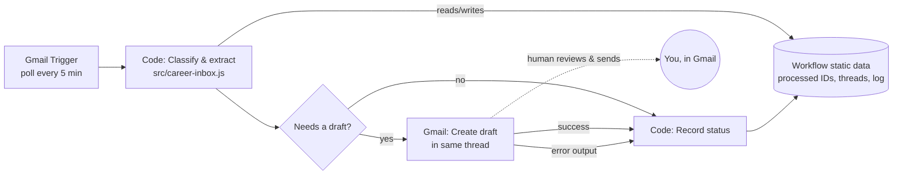

# Career Inbox Automation (n8n + Gmail)

[](https://github.com/iwan-adler/career-inbox-automation/actions/workflows/tests.yml)

An n8n workflow that watches a Gmail inbox for career emails and sorts each one into **internship**, **event**, **university**, **deadline** or **other**. It pulls out the sender, subject, a short summary and any deadline. For emails that need an answer, it **prepares a reply draft for you to review**. It never sends anything itself.

## Why

As a student, internship offers, workshop invites, exam notices and form deadlines all land in the same inbox as food-delivery receipts. Important ones get missed, and replying promptly to recruiters matters. This workflow does the sorting and drafts the first reply, while you stay in control of anything that actually goes out.

**Who would use it:** students, or anyone job hunting, who use Gmail and want a self-hosted, transparent alternative to "AI inbox" products.

## What it does (implemented)

| Requirement | How |
|---|---|
| Detect relevant emails | Gmail Trigger polls every 5 min (`in:inbox -category:promotions -category:social -from:me`); emails with a weak score are marked `other` / `irrelevant` |
| Categorise | Keyword scoring (subject matches count double). Academic sender domains (`.edu`, `.ac.in`, `srmap.edu.in`) count towards *university*. Topic categories win; *deadline* is used for deadline-only emails |
| Extract | Sender name and address, subject, a summary of up to 280 characters (quoted replies and signatures removed), the deadline as `YYYY-MM-DD`, and a priority (`high` if the deadline is within 7 days) |
| Record processing status | Every email ends in **Record status** with one of `drafted`, `draft_failed`, `no_reply_needed`, `no_reply_address`, `thread_already_drafted`, `irrelevant`, `duplicate`, `invalid`. The last 200 records are also kept in the workflow's static data |
| Prevent duplicates | Remembers the last 1000 processed message IDs, and creates at most one draft per Gmail thread |
| Handle malformed data and failures | A broken email becomes `invalid` and the rest of the batch continues. Each result is checked by `validateClassification()` before use. A failed Gmail draft goes to an error branch and is logged as `draft_failed` instead of crashing the run |
| Reply drafts | Templates for internship, event and deadline emails. The draft is created *inside the original thread*, addressed only to the original sender, with `[Your Name]` placeholders you must fill in |
| Human approval | **There is no send step in the workflow.** Drafts wait in Gmail until you review and send them yourself. University notices, `other` emails and `no-reply` senders never get drafts |

**Not implemented:** AI classification. Rules were chosen first because they're free, predictable and testable. An LLM step could later be added in front of the validator (see Next steps).

## Architecture



### Tested code, then deployed

n8n workflows are usually built by clicking in the editor, which makes the logic hard to test or review. Here, all the logic lives in **[`src/career-inbox.js`](src/career-inbox.js)** as plain functions with unit tests. **[`scripts/build-workflow.js`](scripts/build-workflow.js)** pastes that file into the workflow's Code nodes and writes [`workflow/career-inbox-workflow.json`](workflow/career-inbox-workflow.json). One test fails if that file is out of date, and another runs the embedded Code-node JavaScript in a small fake of n8n's environment (`$input`, `$json`, `$()`, `$getWorkflowStaticData`).

```
src/career-inbox.js            classification, extraction, dedup, reply templates, status records
scripts/build-workflow.js      generates the importable n8n workflow JSON
workflow/career-inbox-workflow.json   ← import this into n8n
examples/sample-emails.json    six fake emails, one per outcome, with expected results
tests/                         node:test suites (no dependencies)
```

## Import into n8n

Designed for n8n Cloud or self-hosted n8n.

**Tested on n8n Cloud (13 Oct 2026):** the workflow JSON was imported as-is, connected to an existing Gmail credential, and run against a test internship email. It ended with `status: "drafted"` in **Record status**, and the reply draft appeared in Gmail. Self-hosted n8n has not been tested.

1. In n8n: **Workflows → Add workflow → ⋯ menu → Import from File…** and choose `workflow/career-inbox-workflow.json`. Alternatively, paste the file's contents into the canvas.
2. **Set up the credential.** The export intentionally contains **no credentials**. Open **Gmail Trigger** and choose your existing *Gmail OAuth2* credential, then do the same in **Create Gmail draft**.
3. Click **Test workflow**. n8n fetches recent matching mail and runs it through. Check the **Record status** output and your Gmail **Drafts** folder.
4. When you're happy with it, **activate** the workflow to poll every 5 minutes.

Things to know:

- **Duplicate tracking only works when the workflow is active.** Workflow static data is saved only by production executions, not manual test runs, so a manual run can create the same draft twice.
- **Pre-filtering:** to customise which emails are considered, edit the Gmail Trigger's *Search* field.
- **Keywords:** to change the keywords or university domains, edit the lists at the top of `src/career-inbox.js`, run `npm run build`, and re-import the workflow.

### What depends on n8n Cloud, and what is portable

| Part | Portable? |
|---|---|
| `src/career-inbox.js` logic and tests | Plain JavaScript that runs anywhere with Node 20+ |
| Workflow JSON | Imports into any n8n instance, Cloud or self-hosted (`npx n8n` / Docker) |
| Gmail OAuth2 credential | **Not exported.** It must be recreated in each n8n instance. n8n Cloud provides a ready-made Google sign-in. Self-hosted n8n needs your own Google Cloud OAuth client |
| Workflow static data (dedup memory, log) | Lives inside that n8n instance. It is lost if you move instances, which only matters for duplicate tracking |

If the n8n Cloud trial ends, the same JSON can be imported into a free self-hosted n8n. Only the Gmail credential needs setting up again.

## Development

```bash
npm test             # 76 tests, no dependencies, under a second
npm run build        # regenerate workflow/career-inbox-workflow.json after editing src/
```

What the tests cover:
- the six sample emails end to end
- both Gmail output formats ("Simplify" on and off), and HTML-only emails
- whole-word keyword matching ("international" isn't "intern")
- deadline formats: `20 October 2026`, `25/10/2026` (day-first), `Oct 30th`, ISO dates, `tomorrow`, missing year, invalid dates like 31 Feb, and not reading past the end of a sentence
- summary cleanup
- the validator rejecting malformed results
- no drafts to `no-reply` senders
- duplicates within a run and across runs, and one draft per thread
- a bad email not stopping the batch
- Gmail errors recorded as `draft_failed`
- the workflow's structure: no credentials, no send step, all connections valid

## Limitations

- **Live testing so far is one manual run on n8n Cloud** with a single test email (see *Import into n8n*). The active, every-5-minutes mode and its duplicate tracking across runs are covered by the unit tests, but haven't been observed live over time. Node versions used: Gmail Trigger v1.2, Gmail v2.1, Code v2, If v2. If a future n8n version renames fields on import, check the draft node's *Thread ID* and *To Email* options.
- Keyword rules are English-only and will misclassify some emails. The `scores` and `matchedKeywords` fields in each result show why an email got its category, which makes tuning easier.
- Numeric dates are read day-first (`05/11/2026` = 5 November), the Indian convention.
- The status log is kept in n8n static data, which you see through execution history rather than a spreadsheet.
- Reply templates are generic on purpose. You're expected to edit them before sending.

## Next steps

1. Write the status log to Google Sheets or an n8n Data Table so it's easy to browse.
2. An optional LLM classification step, whose output must pass `validateClassification()`, falling back to the rules when it's malformed.
3. A daily digest draft listing upcoming deadlines.
4. Gmail labels per category.

## Privacy and safety

- No credentials, tokens or real emails are in this repo. The sample emails are invented and use `example.*` domains.
- Email content is only read and pattern-matched. It is never executed, and no draft is ever addressed to an address found inside an email body.
- Nothing is sent automatically.
